# Programme Overview: 180 Days to Junior DevOps Engineering

## Executive Summary

The **180-Day DevOps Engineering Mentorship Programme** is a 24-week professional training framework designed to transform individuals with basic technical awareness into confident, junior-level DevOps and Platform Engineers. 

### Target Junior DevOps Competencies Upon Graduation:
1. **Linux Systems Administration:** Confident navigation, systemd service management, storage administration, user security, and shell scripting.
2. **Network Engineering:** Solid understanding of TCP/IP, DNS resolution, HTTP/HTTPS lifecycle, reverse proxies, packet inspection, and firewall rules.
3. **Application Lifecycle & Databases:** Understanding 3-tier architectures, REST APIs, PostgreSQL administration, connection pools, and containerized backend services.
4. **Containerization & Orchestration:** Authoring secure multi-stage Dockerfiles, Docker Compose architectures, and deploying multi-pod workloads to Kubernetes with Helm.
5. **CI/CD Automation:** Designing reliable GitHub Actions pipelines incorporating automated testing, linting, image publishing to GHCR, and deployment gates.
6. **Infrastructure as Code (IaC):** Architecting modular AWS infrastructure using Terraform, managing remote state locking in S3/DynamoDB, and detecting drift.
7. **Production Telemetry & Observability:** Deploying Prometheus, Grafana, and Node Exporter; authoring PromQL queries, alerting rules, and incident post-mortems.
8. **DevSecOps & Reliability:** Implementing least privilege IAM policies, automated vulnerability scanning (Trivy), database backup/restore drills, and chaos engineering exercises.

---

## Three Stages of Growth

```mermaid
graph TD
    subgraph Stage 1: Technical Foundations
        W1[W1: Linux I] --> W2[W2: Linux II]
        W2 --> W3[W3: Networking I]
        W3 --> W4[W4: Networking II]
        W4 --> W5[W5: Git & GitHub]
        W5 --> W6[W6: Python I]
        W6 --> W7[W7: Automation]
        W7 --> W8[W8: Backend & DB]
        W8 --> Gate1{Progression Gate 1}
    end

    subgraph Stage 2: DevOps Engineering Tools
        Gate1 -->|Pass| W9[W9: Docker I]
        W9 --> W10[W10: Docker II]
        W10 --> W11[W11: CI/CD Fundamentals]
        W11 --> W12[W12: GitHub Actions]
        W12 --> W13[W13: AWS I]
        W13 --> W14[W14: AWS II]
        W14 --> W15[W15: Terraform I]
        W15 --> W16[W16: Terraform II]
        W16 --> Gate2{Progression Gate 2}
    end

    subgraph Stage 3: Production Engineering & Capstone
        Gate2 -->|Pass| W17[W17: Kubernetes I]
        W17 --> W18[W18: Kubernetes II]
        W18 --> W19[W19: K8s Operations]
        W19 --> W20[W20: Observability]
        W20 --> W21[W21: DevOps Security]
        W21 --> W22[W22: SRE & Reliability]
        W22 --> W23[W23: Capstone Build]
        W23 --> W24[W24: Capstone Defense]
        W24 --> Gate3{Final Gate & Graduation}
    end
```

---

## Time Commitment & Hardware Requirements

### Time Commitment
- **Weekdays (Mon–Fri):** 3 to 4 hours per day (morning or evening)
  - 1 hour conceptual reading & documentation
  - 2 hours practical terminal/code exercises
  - 30 minutes documentation and git commit
- **Saturdays:** 2 to 3 hours for the Weekly Challenge & Mentor Demonstration
- **Sundays:** Rest / optional reflection
- **Total Programme Commitment:** ~500 to 600 hours of active deliberate engineering.

### Hardware & Operating System
- **Host Machine:** Minimum 16 GB RAM (recommended for running local Docker and Kubernetes Kind clusters), 4+ CPU cores, 50 GB free disk space.
- **Operating System:** 
  - Ubuntu Linux 22.04 / 24.04 LTS (Native or Dual Boot), OR
  - macOS (Apple Silicon or Intel), OR
  - Windows 11 with **WSL2 (Windows Subsystem for Linux)** running Ubuntu 24.04 LTS.
- **Cloud Account:** AWS Free Tier eligible account with billing alarm configured.
