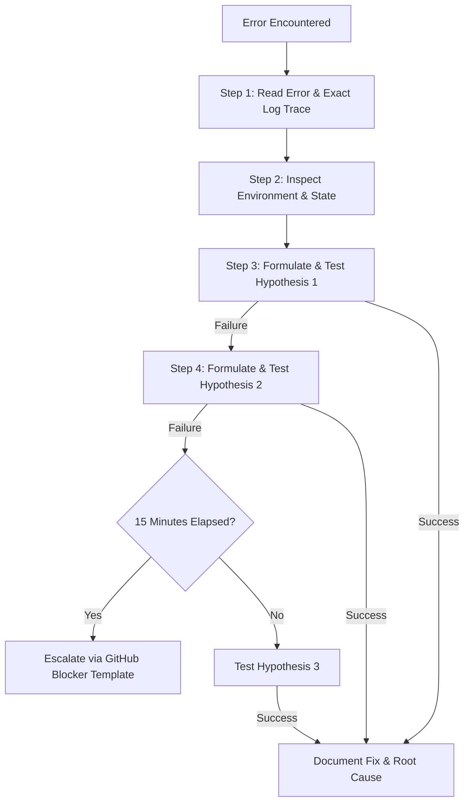

# Learning Expectations & Engineering Mindset

To transition from an aspiring learner to a reliable DevOps engineer, you must cultivate the professional habits, engineering discipline, and mental models of the industry.

---

## 1. The Junior DevOps Mental Model

In traditional software development, success is often defined by writing code that works under happy-path conditions. In DevOps and Site Reliability Engineering, **success is defined by how gracefully systems handle failure, scale under stress, and remain observable.**

### Core Tenets:
1. **Everything Fails, All the Time:** Hardware crashes, networks partition, certificates expire, and disks fill up. Always design for resilience.
2. **Declarative Over Imperative:** Never perform manual configuration changes in production consoles ("ClickOps"). If it is not defined in code and version-controlled, it does not exist.
3. **Automate Repetitive Work:** If you have to execute a series of commands more than twice, write a script or automate it via CI/CD.
4. **Visibility Precedes Optimization:** You cannot manage or fix what you cannot measure. Instrumentation and telemetry must be built-in from day one.

---

## 2. The 15-Minute Rule: How to Troubleshoot Methodically

When an error or outage occurs, avoid erratic guessing. Follow this systematic 4-step diagnostic protocol:

### Steps:
1. **Read the message:** Scroll to the exact error message. Pay close attention to error codes, file paths, and HTTP status codes.
2. **Inspect the state:** Use foundational utilities (`ss -tulpn`, `df -h`, `journalctl -xeu <service>`, `docker logs`, `kubectl describe pod`).
3. **Test hypotheses scientifically:** Change **one variable at a time**. If you change five settings at once, you will never know which one fixed the issue.
4. **Escalate with evidence:** If unsolved after 15 minutes, document the exact commands, errors, and hypotheses before consulting your mentor.

---

## 3. How to Ask Technical Questions Like an Engineer

Poor communication slows down teams and wastes mentor time.

❌ **Bad Question:**
> "Hey, my Docker Compose isn't working. It says error connecting to database. What do I do?"

✅ **Professional Engineering Question:**
> "I am working on Week 10, Assignment A10-04. When starting `docker-compose up`, the `api` service fails with `connection refused to db:5432`.
> 
> Here is what I have verified:
> 1. Running `docker-compose ps` shows the `db` container is running and healthy.
> 2. Both services are on the custom bridge network `app-network`.
> 3. Running `docker-compose exec api ping db` succeeds, confirming DNS resolution.
> 4. However, inspecting `docker-compose logs db` shows PostgreSQL is still initializing the cluster and not yet listening for connections when the API starts.
> 
> My hypothesis is a race condition during startup. I am looking into using a healthcheck with `depends_on: condition: service_healthy`. Could you review my compose file snippet to verify if this is the idiomatic approach?"

---

## 4. Documentation Standards

Every repository, project, and script you write must include:
- **Title and Purpose:** Why does this code exist?
- **Prerequisites:** What software versions or tools must be installed?
- **Configuration:** What environment variables are required?
- **Execution Instructions:** Exact terminal commands to build, test, and run.
- **Verification:** How does an operator verify that the system is operating correctly?
- **Troubleshooting / Known Issues:** What edge cases should an operator be aware of?
